<div align="center">

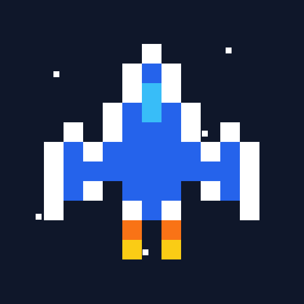

# Escuadrón Estelar

**Shooter espacial pixel art para Android, con historia, tienda de mejoras y jefe final.**


Entrega #4 - Final (Juego) · Aplicaciones Móviles · UPB · Juan José Ospina (JJ)

</div>

## Descripción

El Enjambre destruyó la Base Aurora y solo queda un caza en el aire. En Escuadrón Estelar atraviesas 6 niveles con historia, mejoras tu nave entre misiones y enfrentas a la Reina del Enjambre para volver a casa.

### Características principales

- **Campaña completa:** 6 capítulos con diálogos, escenarios animados, jefe final y cinemáticas de inicio y cierre.
- **8 tipos de enemigos:** cada uno ataca distinto, y los élites dorados son más resistentes.
- **Progresión en cada partida:** las monedas compran mejoras en el Hangar, y al completarlas la nave evoluciona al Fénix.
- **Decisiones durante la acción:** combos hasta x5, roces que cargan la Sobrecarga, eventos sorpresa y power-ups.
- **Rejugable:** 3 dificultades, top 5 guardado y un easter egg por descubrir.
- **Hecho a la medida:** sprites, música y efectos generados por código.

## Capturas

| | | |
|:---:|:---:|:---:|
| 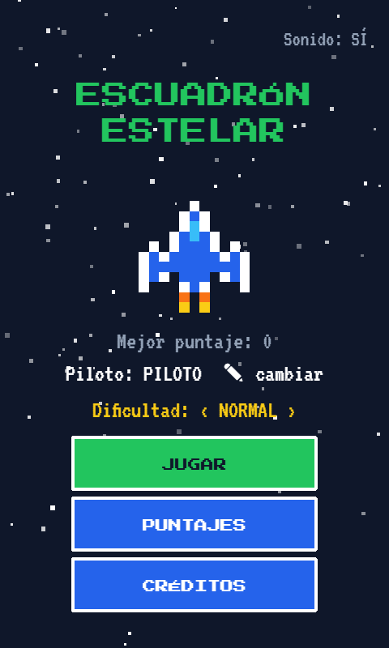 | 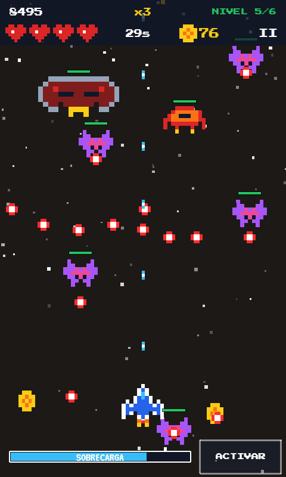 | 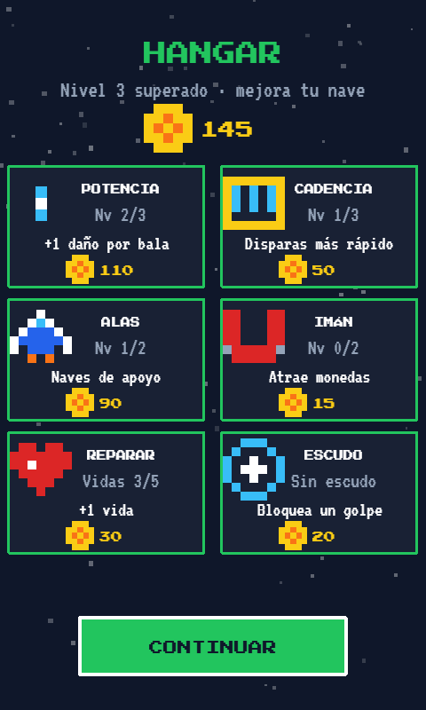 |
| Menú | Partida | Hangar |
| 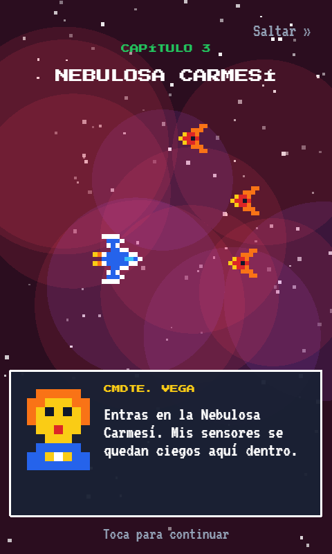 | 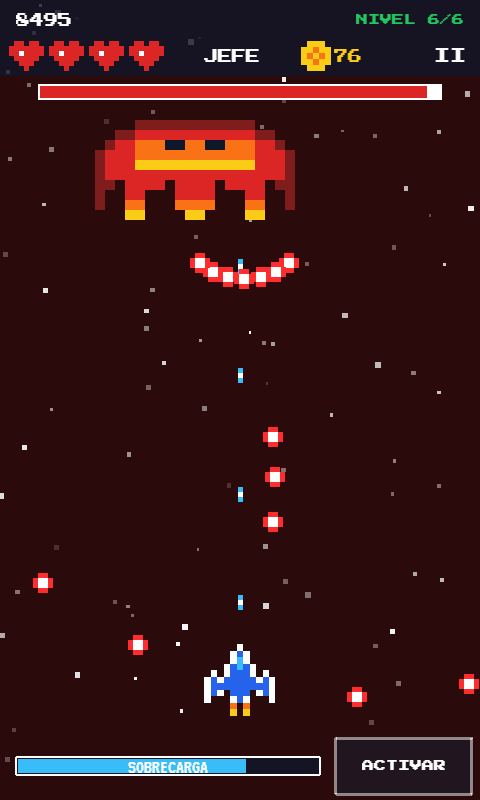 | 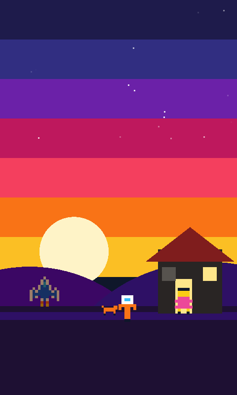 |
| Historia | La Reina | Final |

## Contenido

- [Descripción](#descripción)
- [Capturas](#capturas)
- [Cómo se juega](#cómo-se-juega)
- [Historia y niveles](#historia-y-niveles)
- [Enemigos](#enemigos)
- [Sistemas del juego](#sistemas-del-juego)
- [Dificultad](#dificultad)
- [Pantallas y flujo](#pantallas-y-flujo)
- [Requisitos de la entrega](#requisitos-de-la-entrega)
- [Diseño](#diseño)
- [Tecnología y arquitectura](#tecnología-y-arquitectura)
- [Instalación y ejecución](#instalación-y-ejecución)
- [Pruebas](#pruebas)
- [Publicación en Google Play](#publicación-en-google-play)
- [Privacidad](#privacidad)
- [Uso de IA](#uso-de-ia)
- [Créditos y licencias](#créditos-y-licencias)

## Cómo se juega

La nave dispara sola: tu trabajo es moverte, esquivar y decidir cuándo gastar tus recursos. Cada nivel dura un tiempo fijo; si sobrevives hasta que el contador llega a cero, lo superas. Al terminar los 6 niveles peleas contra la Reina. La partida acaba si te quedas sin vidas o si derrotas a la Reina.

### Controles

| Acción | Android | Navegador |
|---|---|---|
| Mover la nave | Arrastrar el dedo en cualquier parte de la pantalla | Flechas, o arrastrar con el mouse |
| Disparar | Automático | Automático |
| Activar la Sobrecarga | Botón ACTIVAR | Botón ACTIVAR o barra espaciadora |
| Pausar | Botón `II` o botón atrás | Botón `II` |
| Salir de la app | Botón atrás en el menú | No aplica |

El arrastre es relativo, así el dedo no tapa la nave. La nave se mueve en los dos tercios inferiores de la pantalla. El juego también se pausa solo si la app pasa a segundo plano.

### Lo que ves en pantalla

- **Arriba:** puntaje, multiplicador de combo, nivel, vidas, tiempo restante (o `JEFE`), monedas y pausa.
- **Abajo:** barra de Sobrecarga y botón ACTIVAR, que se ilumina cuando la barra está llena.

## Historia y niveles

El Enjambre destruye la Base Aurora. Mientras los civiles escapan, el piloto (que lleva el nombre que elijas en el menú) sube a su caza y despega. Guiado por radio por la comandante Vega, persigue a la flota a través de la galaxia, rescata a los pilotos capturados, cruza la Puerta del Enjambre y enfrenta a la Reina. Después de los créditos, una cinemática lo muestra llegando a casa al atardecer, donde alguien lo esperaba.

Cada capítulo tiene su propio color de fondo, diálogos y escenario animado, y cada uno presenta una amenaza nueva. Los diálogos se pueden saltar.

| Nivel | Capítulo | Duración | Enemigo nuevo | Prob. de élite | Prob. de escuadrón |
|---|---|---|---|---|---|
| 1 | Base Aurora | 30 s | Dron y meteorito | 3% | 5% |
| 2 | Cinturón de Cristal | 30 s | Zigzag | 5% | 7% |
| 3 | Nebulosa Carmesí | 35 s | Kamikaze | 8% | 9% |
| 4 | Luna Prisión | 35 s | Tirador | 10% | 11% |
| 5 | Astillero Negro | 40 s | Acorazado | 12% | 13% |
| 6 | Puerta del Enjambre | 40 s | Orbe | 14% | 15% |
| Final | La Reina | Hasta derrotarla | Jefe final | - | - |

Cada nivel también aumenta la velocidad de los enemigos (de 170 a 270 px/s) y su frecuencia de aparición (de uno cada 800 ms a uno cada 500 ms).

### La Reina del Enjambre

Tiene 320 de vida en dificultad Normal y una barra visible en la parte superior.

1. Ataca con abanicos de balas y ráfagas de 3 disparos apuntados a la nave.
2. Al bajar a 2/3 y a 1/3 de vida se retira y no recibe daño mientras envía oleadas de refuerzos. Vuelve cuando se limpian, o unos 15 s después de la última oleada. La segunda retirada suma orbes y acorazados.
3. Al llegar a la mitad de vida entra en **modo furia**: se mueve y dispara más rápido, con abanicos de 9 balas en vez de 7.

## Enemigos

| Enemigo | Vida | Puntos | Monedas | Comportamiento |
|---|---|---|---|---|
| Dron | 2 | 10 | 1 | Dispara recto; a veces baja en escuadrón de 5 en V |
| Meteorito | 4 | 15 | 1 | No dispara; choca contra la nave |
| Zigzag | 4 | 25 | 2 | Ondea de lado a lado y dispara apuntando |
| Kamikaze | 3 | 30 | 2 | Se detiene, parpadea en rojo y se lanza en picada |
| Tirador | 7 | 45 | 3 | Se queda quieto y dispara ráfagas de 3 |
| Orbe | 9 | 60 | 4 | Gira y suelta anillos de 10 balas |
| Acorazado | 14 | 90 | 6 | Crucero lento que dispara abanicos de 5 |
| Carguero | 12 | 100 | 12 | Solo sale como evento; cruza la pantalla sin atacar |

Por cada nivel, la vida enemiga sube 25% y la cadencia de disparo 15%. Los enemigos con 4 o más de vida muestran una barra sobre ellos.

**Élites (brillo dorado):** tienen el doble de vida y dan el doble de puntos, el triple de monedas y el triple de probabilidad de soltar un power-up.

## Sistemas del juego

### Vidas

Empiezas con 3 vidas en Normal y puedes llegar a 5. Tras un golpe, la nave es invulnerable durante 1.2 s. Al superar un nivel, si tienes menos de 3 vidas subes a 3; si tienes más, las conservas.

### Puntaje y combos

```
puntos ganados = puntos base × multiplicador de combo × factor de dificultad
```

Cada 5 derribos seguidos el multiplicador sube 1, hasta x5. Recibir un golpe (aunque lo absorba el escudo) o pasar 2.5 s sin derribar reinicia el combo. Derrotar a la Reina vale 2000 puntos base.

### Monedas y Hangar

Los enemigos sueltan monedas, que se atraen al pasar cerca. Al terminar un nivel, las monedas en pantalla se cobran solas y recibes un bono de 10 × número de nivel. Luego se abre el Hangar:

| Mejora | Efecto | Precios |
|---|---|---|
| Potencia | +1 de daño por bala | 25 · 60 · 110 |
| Cadencia | 20% menos de tiempo entre disparos por nivel | 20 · 50 · 90 |
| Alas | Hasta 2 naves de apoyo, que disparan uno de cada dos tiros | 40 · 90 |
| Imán | Aumenta el radio de atracción de monedas | 15 · 35 |
| Reparar | +1 vida, hasta 5 (recomprable) | 30 |
| Escudo | Bloquea un golpe (recomprable, uno a la vez) | 20 |

Las monedas y las mejoras duran solo la partida en curso.

### Evolución: el Fénix

Al completar Potencia, Cadencia, Alas e Imán, las cuatro tarjetas explotan y la nave se convierte en el **Fénix**, una nave roja con disparo triple permanente, +2 de daño y 15% menos de tiempo entre disparos. El Fénix aparece también en las escenas de historia y en el final.

### Sobrecarga

Es una habilidad que se carga jugando: cada derribo suma 3 y cada roce suma 8, hasta 100. Un **roce** cuenta cuando una bala enemiga pasa muy cerca sin tocarte, y además da 5 puntos base. Con la barra llena, ACTIVAR da 6 s de **invencibilidad total**, abanico de 5 balas, el doble de cadencia y +2 de daño. La barra no se llena mientras la Sobrecarga está activa.

### Eventos sorpresa

Cerca de la mitad de cada nivel ocurre un evento al azar:

- **Lluvia de meteoritos:** cae una tormenta de 29 meteoritos.
- **Carguero:** una nave con 12 monedas cruza la pantalla; hay que derribarla antes de que escape.
- **Mini-jefe:** baja un acorazado élite (desde el nivel 2).

### Power-ups

Al derribar un enemigo puede caer uno, según la dificultad:

| Power-up | Efecto | Probabilidad |
|---|---|---|
| Disparo triple | 3 balas durante 10 s | 50% |
| Escudo | Absorbe un golpe | 25% |
| Vida extra | +1 vida; con 5 vidas se convierte en escudo | 25% |

### Easter egg

Toca 5 veces el título en el menú para activar el **Modo Gato Espacial**, que cambia la nave por un gato. Se apaga de la misma forma y queda guardado. Los créditos dejan una pista.

## Dificultad

Se elige en el menú y queda guardada.

| | Fácil | Normal | Difícil |
|---|---|---|---|
| Velocidad de enemigos | ×0.8 | ×1 | ×1.25 |
| Tiempo entre enemigos y entre disparos | ×1.3 | ×1 | ×0.75 |
| Vida de enemigos | ×0.75 | ×1 | ×1.3 |
| Vida de la Reina | 192 | 320 | 480 |
| Vidas iniciales | 5 | 3 | 2 |
| Probabilidad de power-up | 15% | 10% | 7% |
| Factor de puntos | ×0.5 | ×1 | ×1.5 |

El factor de puntos hace que el top 5 premie a quien juega en mayor dificultad.

## Pantallas y flujo

| Pantalla | Qué hace |
|---|---|
| Splash | Logo animado y barra de carga; se salta con un toque |
| Home | Jugar, Puntajes, Créditos, nombre del piloto, dificultad, sonido y mejor puntaje |
| Intro | Cinemática del piloto subiendo a la nave y despegando; se salta con un toque |
| Juego | Niveles, jefe final, HUD y toda la acción |
| Pausa | Capa sobre el juego: continuar, volver al menú y sonido |
| Hangar | Tienda de mejoras y evolución al Fénix |
| Historia | Diálogos por radio y escenario animado de cada capítulo |
| Puntajes | Resultado de la partida y top 5 |
| Créditos | Equipo, tecnologías, uso de IA y pista del easter egg |
| Final | Cinemática después de los créditos, solo al ganar |

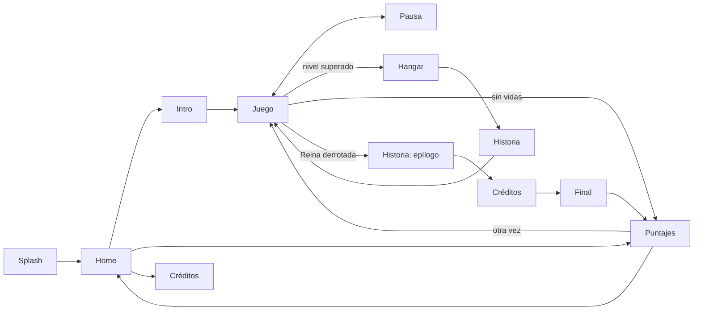

## Requisitos de la entrega

| Requisito | Cumplimiento |
|---|---|
| Mínimo 3 niveles, tiempo o vidas | 6 niveles con tiempo, más jefe final y sistema de vidas |
| Híbrido o nativo | Híbrido con Capacitor |
| Splash, Home, Juego, Puntaje y Créditos | Las 5, más Intro, Pausa, Hangar, Historia y Final |
| UI personalizada | Pixel art, botones y HUD propios, sin componentes genéricos |
| Persistencia entre vistas | Top 5, nombre, dificultad, sonido y easter egg en `localStorage`; la partida pasa entre escenas |
| Animaciones | Tweens, partículas, sacudidas de cámara y cinemáticas |
| Sonidos | Música y 20 efectos chiptune generados por código, más vibración en Android |
| Repositorio | [github.com/juann11/Juego_Final](https://github.com/juann11/Juego_Final) |
| Wireframe en grises | [Figma](https://www.figma.com/design/Rmgk68Xv0oKn7tQiDzksmf) y [`docs/wireframes.svg`](docs/wireframes.svg); boceto en papel en [`docs/papel/`](docs/papel) |
| Bonus: easter eggs | Modo Gato Espacial |
| Bonus: multijugador Firebase | No implementado |

## Diseño

El diseño empezó con bocetos a mano y luego pasó a wireframes digitales en escala de grises:

- **Papel:** bocetos de Home, Intro, Juego, Pausa, Hangar, Historia, Puntajes, Créditos y Final, en [`docs/papel/`](docs/papel).
- **Figma:** [Escuadrón Estelar - Wireframes](https://www.figma.com/design/Rmgk68Xv0oKn7tQiDzksmf), las 10 pantallas con capas editables y un componente de botón.
- **Repositorio:** [`docs/wireframes.svg`](docs/wireframes.svg), copia de los wireframes digitales.

| | | |
|:---:|:---:|:---:|
| 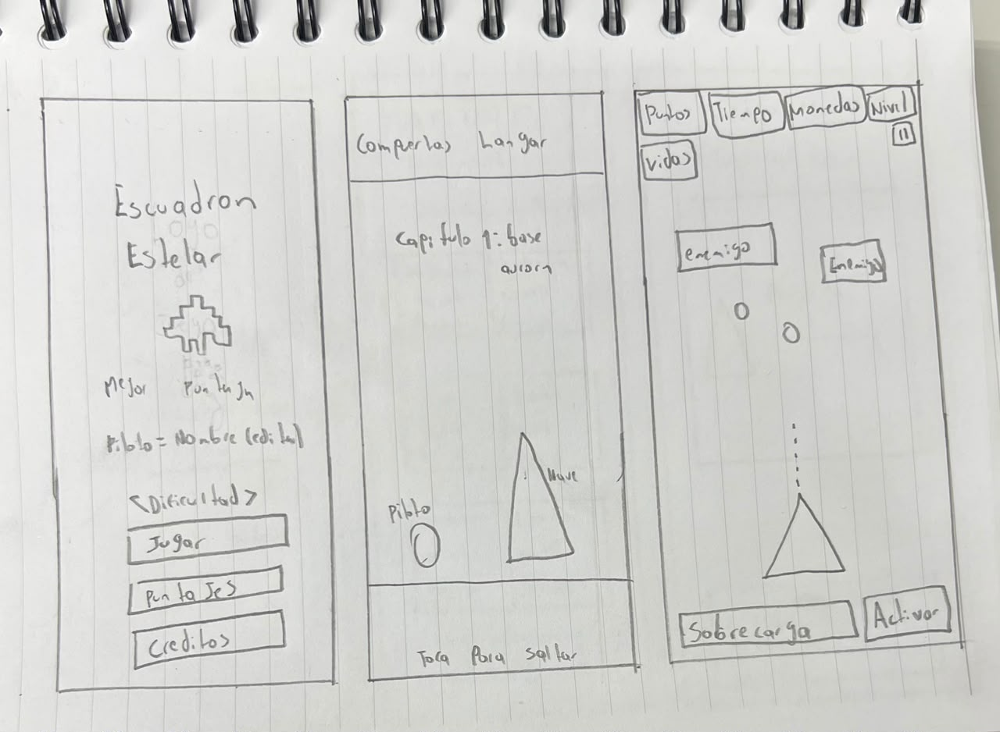 | 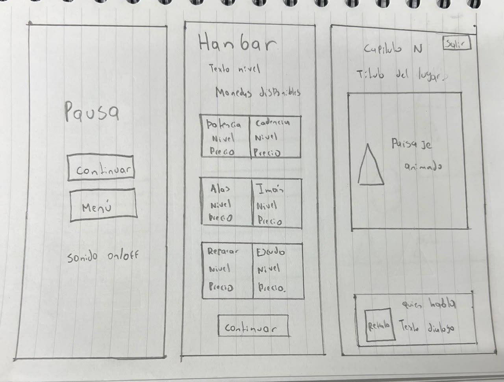 | 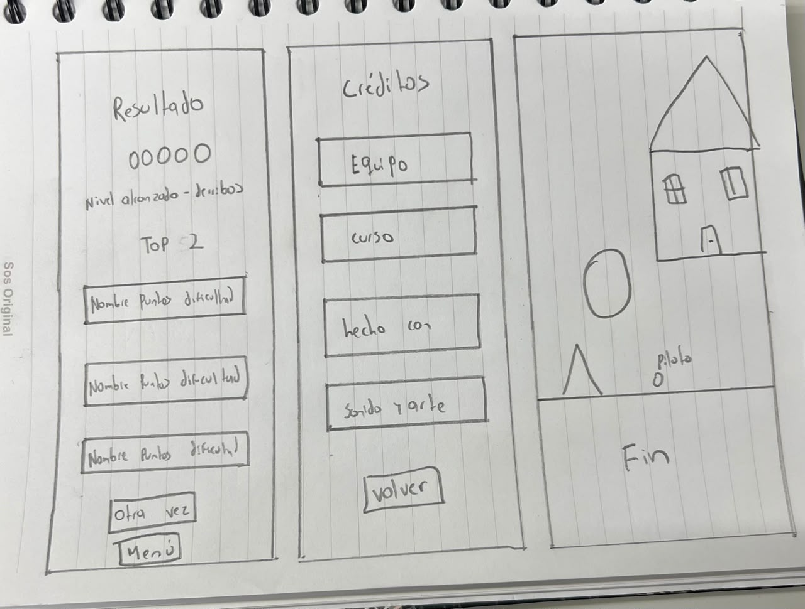 |
| Home · Intro · Juego | Pausa · Hangar · Historia | Puntajes · Créditos · Final |

La identidad visual es de arcade retro: fondo azul noche `#0F172A`, verde para títulos y acciones, azul para botones secundarios, dorado para recompensas y rojo para el peligro. Los títulos usan Press Start 2P y los textos VT323. Las balas enemigas son rojas con centro blanco para distinguirlas de cualquier fondo.

## Tecnología y arquitectura

| Herramienta | Uso | Por qué |
|---|---|---|
| Phaser 3 | Escenas, física, tweens y partículas | Motor 2D probado que corre en WebView |
| TypeScript | Lenguaje | Detecta errores de tipos antes de jugar |
| Vite | Servidor de desarrollo y build | Arranque y recarga rápidos |
| Capacitor | Empaquetado Android | Convierte el build web en una app nativa instalable |
| Vitest | Pruebas | Se integra con Vite y TypeScript sin configuración extra |

Android: `minSdk` 24 (Android 7), `targetSdk` y `compileSdk` 36, orientación vertical. El lienzo es de 480×800 y se escala a cada pantalla.

### Estructura

```
src/
  logica/        Reglas del juego, sin Phaser
    partida.ts   Niveles, vidas, combos, mejoras, sobrecarga, eventos y jefe
    historia.ts  Guion de capítulos, epílogo y textos del final
    puntaje.ts   Top 5
    nombre.ts    Limpieza del nombre del piloto
  escenas/       Una clase por pantalla, más paisajes.ts (escenarios animados)
  almacen.ts     Persistencia en localStorage
  editorTexto.ts Editor del nombre, con el teclado del celular
  sonido.ts      Música y efectos con Web Audio
  texturas.ts    Sprites pixel art definidos como matrices de texto
  ui.ts          Paleta, fuentes, botones y transiciones
  main.ts        Arranque de Phaser y botón atrás de Android
tests/           Pruebas con Vitest
docs/            Wireframes y capturas
assets/          Ícono de 512 px para Google Play
android/         Proyecto nativo generado por Capacitor
```

### Decisiones clave

- **Lógica separada de Phaser.** Las reglas son funciones puras en `src/logica`: reciben el estado y devuelven uno nuevo. Así se prueban sin abrir el juego, y las escenas se limitan a dibujar y reaccionar.
- **Balance en un solo lugar.** Vidas, precios, enemigos y niveles están en constantes al inicio de `partida.ts` (`ENEMIGOS`, `MEJORAS`, `NIVELES`, `DIFICULTADES`).
- **Azar inyectado.** `elegirEnemigo` y `elegirEvento` reciben el número aleatorio como parámetro, para que los tests den siempre el mismo resultado.
- **Arte y sonido por código.** Los sprites y el audio se generan en tiempo de ejecución: no hay archivos que cargar ni licencias que gestionar, y la app es liviana.
- **`localStorage` para guardar.** Funciona igual en el navegador y en el WebView de Capacitor, sin dependencias nuevas.

Se guardan, con el prefijo `esquiva-estelar:`, las claves `top`, `nombre`, `dificultad`, `sonido` y `secreto`. El prefijo y el identificador `com.upb.esquivaestelar` conservan el nombre inicial del proyecto.

## Instalación y ejecución

**Requisitos:** Node.js 22 o superior (probado con 24). Para Android: Android Studio con el SDK 36.

```bash
git clone https://github.com/juann11/Juego_Final.git
```

```bash
cd Juego_Final
```

```bash
npm install
```

| Comando | Qué hace |
|---|---|
| `npm run dev` | Abre el juego en el navegador en modo desarrollo |
| `npm test` | Corre las pruebas |
| `npm run build` | Revisa tipos y genera el build web en `dist/` |
| `npm run android` | Genera el build y lo copia al proyecto Android |
| `npx cap open android` | Abre el proyecto en Android Studio |

Para instalar en un celular o emulador, corre `npm run android` y `npx cap open android`, y pulsa **Run** en Android Studio.

Para generar un APK de prueba desde la terminal, con `JAVA_HOME` apuntando al JDK de Android Studio:

```bash
cd android && ./gradlew assembleDebug
```

El archivo queda en `android/app/build/outputs/apk/debug/app-debug.apk`.

## Pruebas

```bash
npm test
```

La suite tiene **93 pruebas en 6 archivos**, todas en verde. La lógica del juego se desarrolló con TDD: primero la prueba, luego el código.

| Archivo | Qué cubre |
|---|---|
| `partida.test.ts` | Niveles, vidas, combos, power-ups, tienda, evolución, sobrecarga, eventos, fases del jefe y dificultad |
| `historia.test.ts` | Un capítulo por nivel y sustitución del nombre del piloto |
| `puntaje.test.ts` | Orden y límite del top 5 |
| `almacen.test.ts` | Guardado, valores por defecto y datos dañados |
| `nombre.test.ts` | Limpieza y límite del nombre |
| `editorTexto.test.ts` | Edición, aceptación y cancelación del nombre |

**Pruebas manuales:**

| Entorno | Qué se verificó |
|---|---|
| Navegador | Flujo de pantallas, teclado y mouse |
| Emulador Android (Pixel 9) | Toques, arrastre, botón atrás, pausa y fin de partida |
| Celular Android físico | Partida completa, sonido, vibración y Sobrecarga con un segundo dedo |

## Publicación en Google Play

**Estado:** versión 1.0 firmada y lista para subir a Play Console.

Para generar una versión nueva:

1. Sube `versionCode` y `versionName` en `android/app/build.gradle` (la versión actual es la 1.0, código 1).
2. Corre `npm run android` y `npx cap open android`.
3. En Android Studio: *Build → Generate Signed App Bundle / APK → Android App Bundle*, y firma con la llave de subida del proyecto. La llave y su contraseña se guardan fuera del repositorio.
4. Sube el `.aab` a Play Console.
5. Completa la ficha con el ícono de [`assets/icono-play-512.png`](assets/icono-play-512.png), las capturas de `docs/capturas/` y el enlace a la sección [Privacidad](#privacidad).

Los keystores (`*.jks`, `*.keystore`) y los archivos `.env` están en `.gitignore`.

## Privacidad

Escuadrón Estelar no pide cuentas, no recopila datos personales, no muestra anuncios y no envía información a ningún servidor. El nombre del piloto, los puntajes y las preferencias se guardan solo en tu dispositivo, y se borran al desinstalar la app o limpiar sus datos.

## Uso de IA

El curso permite usar IA si se justifica y se entiende el código. **Claude Code** se usó como asistente para programar, generar pruebas y documentar. El autor definió las ideas y los cambios del juego, probó cada iteración y reportó los errores encontrados. Los créditos del juego también lo declaran.

## Créditos y licencias

- **Autor:** Juan José Ospina (JJ)
- **Curso:** Aplicaciones Móviles, UPB
- **Sprites, música y efectos:** creados por código para este proyecto
- **Fuentes:** Press Start 2P y VT323 (SIL Open Font License)
- **Librerías:** Phaser y Capacitor (MIT)
